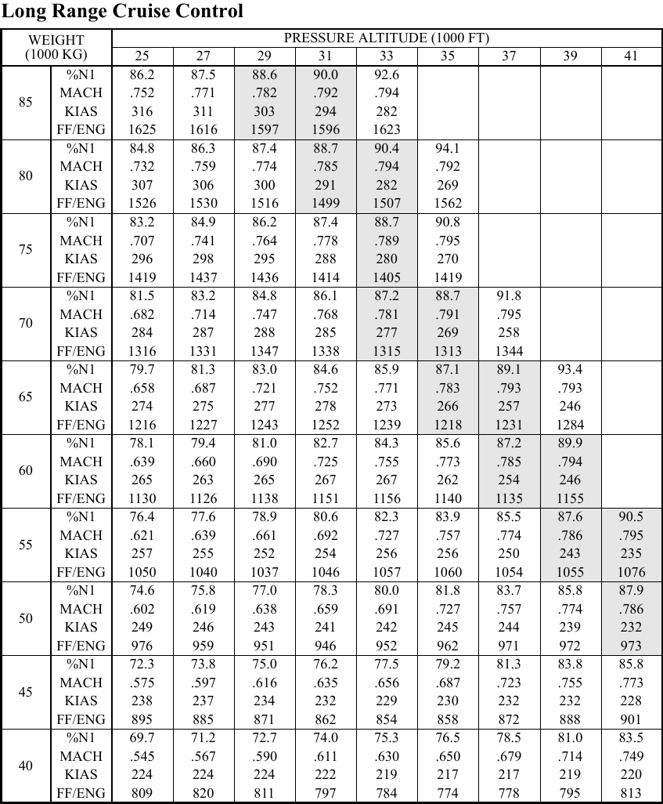
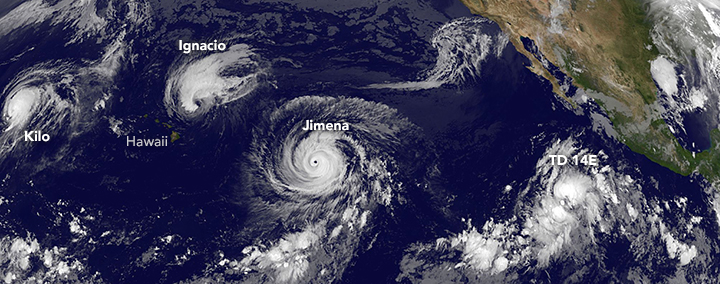

# Case Study: Air Traffic Controller

MS | Math | Case Study | 2026-27 | Heroes Academy

---

## Overview

"Air traffic control, this is ASA862. We're currently about twelve hundred miles northeast of OGG, bearing 26°45'22" N, 149°43'31" W, heading your way — and we've lost power to one of our engines." Captain James Carter's voice is flat, controlled, the way pilots are trained to sound no matter what's happening in the cockpit behind it.

"We have you on our screens, Flight 862," Sea-Tac air traffic controller Desirae Underwood answers, already pulling the strip off her board and reaching for a second headset. "Do you have any medical emergencies on board?"

"No, ma'am. Cabin's shaken up, nobody hurt. Walk you through our instrument readings now." He does. Desirae listens, pen moving, and everything sounds almost normal — except the fuel numbers. They're wrong. Not catastrophic. Just wrong, in a way that's getting worse the longer she watches them.

"Flight control," the captain says, quieter now, "we're seeing an unusual drop in fuel. We may have a leak."

Desirae's screen shows a single green dot, hours from anywhere, over open ocean. Behind her, the watch supervisor has already stopped pretending to look at something else. She keys the mic.

"Copy that, Flight 862. We're going to divert your destination."

Her hand hovers over the flight strip. Two airports are within reach. Neither one is close.

---

## Background

**Desirae Underwood** is the Seattle-Tacoma (SEA-TAC) air traffic controller now responsible for **Alaska Airlines Flight 862** — a Boeing 737-800 that departed Kahului Airport (OGG), Maui, this morning bound for Seattle-Tacoma International Airport (SEA), carrying 139 passengers (**SEE APPENDIX A**).

Shortly after takeoff, while climbing through the edge of an approaching typhoon, the aircraft was struck by unexpected hail — a rare event inside a typhoon's outer bands. The crew climbed above the weather to their planned cruising altitude and speed, but moments later one engine erupted in flames. The crew shut the engine down and the fire went out, but power to that engine could not be restored. Losing an engine cost the aircraft both altitude and speed: Flight 862 is now flying at a lower altitude and a reduced cruising speed than planned, on its one remaining engine (**SEE APPENDIX A**).

Shortly after, the crew reported an additional problem: the instrument panel is showing fuel consumption well above what the aircraft should be burning on one engine, consistent with a fuel line damaged in the same hailstorm that disabled the engine (**SEE APPENDIX E**). The aircraft departed OGG with a full fuel tank; some of that fuel is already gone, burned normally before the failure, and the fuel line issue is now consuming more with every mile flown (**SEE APPENDIX F**).

There are only two realistic options for a trans-Pacific flight in this position. The plane can turn back toward **Operation Kahului Return** — reversing course into the same typhoon that produced the hail that damaged it in the first place — or continue on toward **Operation Golden Gate Divert** — a longer leg, but through clear air the whole way, to the nearest airport on the mainland with a runway long enough for a 737-800 landing on one engine, San Francisco International Airport (SFO) (**SEE APPENDIX D**).

Both routes are flyable. Neither is free of risk, and the aircraft does not have fuel to spare on either one (**SEE APPENDIX F**). Desirae has to tell Captain Carter which way to point the airplane, now, before he has to make the call himself.

Curious how real twin-engine jets are certified to fly this kind of route on one engine, or how real air traffic controllers use math on the job? **SEE APPENDIX G** for further reading.

Suggested starting points for Challenge 1's research task are listed in **Appendix B**. The vocabulary and the "how to…" skills this case will ask of you are listed in **Appendix H** — that is where Challenge 1 sends you.

---

## Dilemma

You are Air Traffic Controller Desirae Underwood.

Do you:

**A.)** Order the plane to return to OGG — **Operation Kahului Return** **OR**

**B.)** Divert the plane to SFO — **Operation Golden Gate Divert**

---

## Challenges

1.) Research and find an online resource that answers one of the "how to…" questions from the case study launch. Post a link to the resource as your submission.

2.) Post 250 or more "excellent" words pitching a firm stance to your audience on which you would choose and why. Your pitch must include:
    a.) Use of the "how to…" resource you researched in Challenge 1.
    b.) At least one original visual display of the data.

3.) Include the following:

- **D1 — A steady-state fuel-flow rate.** Using Appendix E's fuel-flow readings, identify the readings that have leveled off (stopped changing meaningfully) and compute their mean. This is the rate the flight will burn at for the rest of either route.
- **D2 — A total-fuel-burned calculation for Option A** (Operation Kahului Return): the fuel already burned flying normally before the failure (Appendix F), plus the fuel burned at your D1 rate over the full return distance to OGG (Appendix A).
- **D3 — A total-fuel-burned calculation for Option B** (Operation Golden Gate Divert): the same two-part calculation, using the distance from the aircraft's current position to SFO (Appendix A) instead.
- **D4 — A side-by-side comparison table**, in both gallons and liters, of the fuel remaining in the tank at touchdown for Option A vs. Option B (starting fuel minus each option's total burn from D2/D3).
- **D5 — A cruise-performance lookup.** Using Appendix F, compute the aircraft's approximate current weight (starting weight minus the weight of the fuel already burned before the failure). Using that weight and the aircraft's current altitude, look up the recommended cruising airspeed (KIAS) and fuel flow from Appendix C's performance table.

4.) An appendix showing evidence of your original thinking, work, calculations and processes you used to complete the challenges (pictures, screenshots, notes, etc.). Your work in the appendix does not count toward your word count.

5.) Participate twice or more in the Case Study discussion. *If you are absent the day of a discussion post 500 "excellent" words on the questions above.

---

## Appendix A: Flight Path & Position

Flight 862's filed route ran from OGG to SEA. At the moment of the engine failure the aircraft was already well along that route:

| Leg | Distance |
|---|---|
| Current position → OGG (Option A, return) | 1,200 statute miles |
| Current position → SFO (Option B, divert) | 1,214 statute miles |

The distance to SFO is computed using the great-circle ("as the crow flies over a curved Earth") method from the aircraft's tracked position to SFO's published coordinates — the same method real flight-dispatch software uses for a diversion this size (**[S1]**, **[S2]**, **[S3]**).

For reference, here is a real historical FlightAware track of the planned OGG → SEA route this flight was following before the emergency (position and cruise numbers on the image are illustrative of the *planned* flight, not the current emergency state):

*(Image: FlightAware historical track, OGG → SEA, included as a real reference for what this route looks like on a map. It does not show the SFO diversion option.)*

---

## Appendix B: Suggested Research Topics (Challenge 1)

Two starting points for your Challenge 1 "how to…" research:

- How single-engine flight affects a twin-engine jet's range, speed, and fuel economy.
- The relationship between Mach number, indicated airspeed, and altitude for a jet aircraft.

---

## Appendix C: Long Range Cruise Performance Table

A cruise-performance table for a Boeing 737-800, giving the recommended long-range-cruise settings at different aircraft weights and pressure altitudes.

| Weight (1,000 kg) | | Pressure Altitude (1,000 ft) 25 | 27 | 29 | 31 | 33 | 35 | 37 | 39 | 41 |
|---|---|---|---|---|---|---|---|---|---|---|
| **60** | %N1 | 78.1 | 79.4 | 81.0 | 82.7 | 84.3 | 85.6 | 87.2 | 89.9 | — |
| | MACH | .639 | .660 | .690 | .725 | .755 | .773 | .785 | .794 | — |
| | KIAS | 265 | 263 | 265 | 267 | 267 | 262 | 254 | 246 | — |
| | FF/ENG (kg/hr) | 1130 | 1126 | 1138 | 1151 | 1156 | 1140 | 1135 | 1155 | — |
| **65** | %N1 | — | 79.7 | 81.3 | 83.0 | 84.6 | 85.9 | 87.1 | 89.1 | 93.4 |
| | MACH | — | .658 | .687 | .721 | .752 | .771 | .783 | .793 | .793 |
| | KIAS | — | 274 | 275 | 277 | 278 | 273 | 266 | 257 | 246 |
| | FF/ENG (kg/hr) | — | 1216 | 1227 | 1243 | 1252 | 1239 | 1218 | 1231 | 1284 |
| **70** | %N1 | 81.5 | 83.2 | 84.8 | 86.1 | 87.2 | 88.7 | 91.8 | — | — |
| | MACH | .682 | .714 | .747 | .768 | .781 | .791 | .795 | — | — |
| | KIAS | 284 | 287 | 288 | 285 | 277 | 269 | 258 | — | — |
| | FF/ENG (kg/hr) | 1316 | 1331 | 1347 | 1338 | 1315 | 1313 | 1344 | — | — |

*(A full weight range of 40–85 (1,000 kg) is available; only the rows near this flight's weight are reproduced here. FF/ENG is fuel flow per engine, in kilograms per hour, at the listed cruise setting — a different unit from Appendix E's per-mile leak-rate readings.)*

This table's specific values could not be matched against a public Boeing 737-800 flight manual excerpt (that documentation is proprietary to Boeing and airline operators) — see the Modeling Assumptions note in Appendix F. They are structurally consistent with publicly reported 737-800 long-range-cruise ranges (roughly Mach .6–.8, 220–320 KIAS) (**[S5]**).

---

## Appendix D: Weather

**Current wind report:** headwind, west-southwest, 7.6 meters per second.

**Typhoon Ignacio:** has stalled northeast of Hawaii, in the direction of the return route to OGG. Between the aircraft's current position and SFO, weather is clear the whole way.

*(Image: a real satellite photograph of three simultaneous Pacific storms named Kilo, Ignacio, and Jimena, near Hawaii — a real historical weather event from August 2015 (**[S6]**), used here as illustrative art for this case's invented, differently-dated storm named "Ignacio." It is not a live or current image.)*

---

## Appendix E: Current Fuel Consumption (Instrument Panel Readings)

Readings from the aircraft's fuel-flow instrument since the moment of engine failure, for the one remaining engine:

| Time Since Engine Failure | Fuel Flow (gallons per mile) |
|---|---|
| 0 m 00 s | 0.736 |
| 1 m 20 s | 0.95 |
| 2 m 15 s | 1.4 |
| 2 m 55 s | 2.61 |
| 3 m 40 s | 3.5 |
| 5 m 05 s | 3.71 |
| 5 m 40 s | 3.75 |
| 6 m 30 s | 3.73 |
| 7 m 10 s | 3.76 |

---

## Appendix F — Modeling Assumptions

**Aircraft and fuel data (given):**

- Takeoff weight: 66,500 kilograms.
- Passengers: 139.
- Fuel tank capacity at takeoff: 6,875 US gallons (26,025 liters) — a full tank.
- Standard (two-engine, maximum-speed) fuel burn: 4.88 US gallons per seat per hour (18.5 liters per seat per hour).
- Cruising speed and altitude before the failure: 542 miles per hour at 35,000 feet.
- Cruising speed and altitude after the failure (current): 418 miles per hour at 25,000 feet.
- 1 US gallon of Jet A fuel weighs approximately 6.7 pounds (3.04 kilograms) (**[S4]**).

**Modeling Assumptions:**

- **MA1 — steady-state leak rate.** This case models the fuel-flow rate for the remainder of either route using the *plateaued* value from Appendix E — the readings from 5 m 05 s onward, once the rate has stopped climbing — rather than the changing rate during the first five minutes after the failure. The readings before 5 m 05 s cover only a small fraction of either remaining route and are not used in D2/D3's totals.
- **MA2 — pre-failure burn uses the standard rate.** Fuel burned *before* the failure (both engines, normal cruise) is modeled using the standard burn rate above over the time it took the aircraft to reach its current position at its pre-failure cruising speed — the aircraft was operating normally for that entire stretch, so the leak-rate table (which only starts at the moment of failure) does not apply to it.
- **MA3 — weight-bracket lookup.** For D5, this case uses the nearest Appendix C weight bracket *at or below* the computed current weight, at the aircraft's current altitude — a standard conservative convention for a quick manual table lookup, rather than interpolating a weight value the table does not list.

---

## Appendix G: Learn More

Real, further-reading resources — beyond what the Challenges require — for students curious about the real-world math, engineering, and science behind this case:

- **[FAA Smart Skies™](https://www.faa.gov/education/programs/middle/smartskies)** — the FAA's own free math program for middle-school students, built around the same proportional-reasoning skills (distance, rate, time) a real air traffic controller uses to resolve conflicts, with an online air-traffic simulator.
- **[NASA — LineUp with Math](https://www.nasa.gov/directorates/armd/lineup-with-math/)** — NASA and the FAA's joint air-traffic-control math program: six increasingly complex problem sets, a downloadable simulator, and student workbooks built on the same "manage the aircraft with math" idea as this case.
- **[Wikipedia — ETOPS](https://en.wikipedia.org/wiki/ETOPS)** — explains the real safety standard that governs how far a twin-engine jet like the 737-800 is allowed to fly from a diversion airport, including on a single engine, which is exactly Flight 862's situation.
- **[NOAA — Hurricanes, Cyclones and Typhoons: What's in a Name?](https://www.nesdis.noaa.gov/news/hurricanes-cyclones-and-typhoons-whats-name)** — NOAA explains that hurricanes, cyclones, and typhoons are the same storm phenomenon under different regional names, and why the Pacific storm in this case is called a "typhoon."
- **[NOAA Ocean Service — How Do Hurricanes Form?](https://oceanservice.noaa.gov/facts/how-hurricanes-form.html)** — a short, official explainer on the real atmospheric conditions (warm ocean water, low pressure, low wind shear) that create storms like the one Flight 862 is trying to avoid.

---

## Appendix H: "How To…" Math Questions To Research

**Vocabulary**

Distance · Mean · Place Value · Rounding · Weight · Proportion · Unit

**How to…**

- How to convert an amount with compound units
- How to convert an amount from one unit to another unit
- How to convert between units of time
- How to add and subtract time
- How to multiply decimal numbers
- How to subtract decimal numbers
- How to subtract multi-digit numbers
- How to find the mean of a set of data
- How to round a number to a specified place value
- How to compare two or more values
- How to find a missing amount in a proportion

<!-- FACILITATOR ONLY: balance argument, margin, and sensitivity notes live in FACILITATOR.md and case.json's balance object, not here. -->
