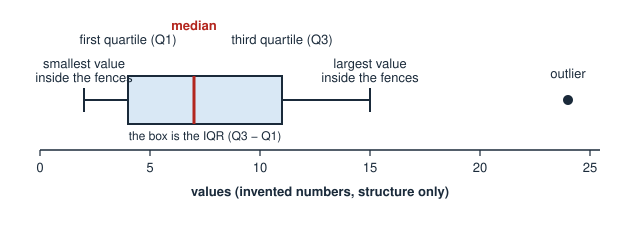

# Case Study: The Busiest Century

MS | Math | Case Study | 2026-27 | Adventure

---

## Overview

Linnea Dalgleish stands alone at the foot of the long blank wall, and the whole gallery smells of fresh paint and cut vinyl. Her shoes squeak on a floor no one has walked on yet. A ventilation fan ticks overhead, and from the stairwell comes the muffled sound of a school group being told to line up in pairs.

Everything in the room is ready except the sentence that goes on this wall. It is the first thing every visitor will read. Guides will say it aloud, teachers will copy it onto worksheets, and children will read it twice because it is bigger than they are.

The sentence is meant to answer one friendly question about the records the new gallery is built around: in which century do they show the busiest stretch? She has the public record of radiocarbon dates from New Mexico, and two honest ways to answer. One counts the dated samples. The other counts the different places those samples came from. She has checked both, and they do not point at the same century.

By the loading door, the sign-maker waits with trays of cut letters sorted by height and a pencil behind one ear. He stopped asking whether she was sure a while ago. He has been polite for most of an hour.

"Ms. Dalgleish," he calls across the empty gallery. "I have to start cutting. Which century goes on the wall?"

Linnea opens her mouth to answer.

---

## Background

Linnea Dalgleish is the exhibit developer at a county museum in New Mexico. She does not decide what the museum believes about the past; her job is to write wall text that the evidence supports and that a child can read in one breath. The letters are cut once, from the proof she approves, and the museum cannot afford a recut. *(Constructed framing, disclosed: the museum, Linnea and the sign-maker are invented. The radiocarbon records are real.)*

The evidence is the p3k14c database, release 2025.07, published July 2025 and read on 2026-10-28; nothing newer is used (SEE APPENDIX E, M0) [S1]. Each row is one radiocarbon date: a measured age, its error, the kind of sample (charcoal, seeds, wood and so on) and the archaeological site the sample came from. Appendix A explains how a measured age becomes a probability spread over calendar years [S2], and why this case hands you finished tables instead of 3,616 dates to calibrate by hand (SEE APPENDIX A). Site names, numbers and locations are left out of this packet on purpose: federal law lets agencies withhold the location of a historic property when sharing it could put the property at risk [S7].

The scope was fixed before any result was looked at (SEE APPENDIX E, M1): New Mexico dates with a recorded site, a measured age between 100 and 8,000 radiocarbon years, an error under 300 years, and no bone or teeth samples. That leaves 3,616 dates from 863 sites.

Two readings of "busiest" are on the table, and the wall has room for one.

- **The Dates Wall** (Option A) headlines the century with the most dates. Each date counts once in total, shared out across the centuries in proportion to how likely each one is.
- **The Sites Wall** (Option B) headlines the century with the most sites showing dated activity: the expected number of different sites with at least one dated sample in that century. A site counts once however many dates it has.

Both readings are worked out for every century in Appendix B (SEE APPENDIX B). Centuries are 100 years wide and start at 0, 100, 200 and so on years before present (BP, where "present" is 1950 CE). Appendix B also gives the same centuries shifted 50 years, Appendix C counts the dates at each site, and Appendix D shows what happens if every date is squeezed to a single year before counting (SEE APPENDICES C AND D). To compare the two winning centuries, the case uses a blended score with a weight *s* that you choose (SEE APPENDIX E, M5).

The museum's rule for the wall is that it says what the records show about when places have dated activity, and makes no claim about how many people lived anywhere. A century with more dates can mean more activity, but it can also mean more digging, better preservation, or more money for dating (M6). Native communities, including the Pueblos, live in New Mexico today, and places across this region are part of their history [S6]. The wall is about what the records show, and a word such as "vanished" or "mystery" is not something the records can support.

The Appendices hold the method (A), the tables (B, C, D), the assumptions (E), the "How To…" list (F), plain-English notes (G) and every source (H).

---

## Dilemma

You are Linnea Dalgleish.

Do you:

**A.)** Headline the century with the most radiocarbon dates (The Dates Wall) **OR**

**B.)** Headline the century with the most sites showing dated activity (The Sites Wall)

---

## Challenges

1.) Research and find an online resource that answers one of the "how to…" questions from the case study launch. Post a link to the resource as your submission.

2.) Post 250 or more "excellent" words pitching a firm stance to your audience on which you would choose and why. Your pitch must include:
    a.) Use of the "how to…" resource you researched in Challenge 1.
    b.) At least one original visual display of the data.

3.) Your pitch must include:

- **D1 — A ranking from Appendix B.** For each reading (dates, sites), the top three centuries (centuries starting 0, 100, 200 …) and their values. Then, for the winning century of each reading, give both readings' values for both winning centuries, and the gap between the two winning centuries on each reading, as a percent of the larger of the two values.
- **D2 — A box-and-whisker plot of dates per site, from Appendix C.** Give the smallest value, first quartile, median, third quartile and largest value; the interquartile range (IQR); the two fences, Q1 − 1.5 × IQR and Q3 + 1.5 × IQR; the number of sites that are outliers (more than 1.5 × IQR beyond a quartile); and the mean number of dates per site. Draw the plot with the whiskers ending at the most extreme values inside the fences and the outliers as separate points. Say in one sentence what the outliers could do to the Dates reading.
- **D3 — A table of five cuts.** For each of five ways of cutting the same dates (Appendix B centuries starting at 0; Appendix B centuries shifted 50 years; and the median, mean and mode single-year shortcuts in Appendix D), name the winning century on the dates reading and on the sites reading, give each winner's lead over its own runner-up as a percent of the winner, and say whether the two readings agree. Then say which of your D1 findings survive every cut and which do not.
- **D4 — A weighted score and a wall sentence.** Score each of the two winning centuries from D1 as (1 − *s*) × dates score + *s* × sites score, where a century's dates score is its Appendix B dates value ÷ the largest dates value in Appendix B, and its sites score is its sites value ÷ the largest sites value (Appendix E, M5). Give both scores at *s* = 0.5. Find the weight *s* at which the two scores tie (a table in steps of 0.1 that brackets the tie is acceptable; solving for it exactly is better). State the *s* you would defend and why. Then write the sentence for the wall (20 words or fewer) and two sentences defending it, including one thing the sign does not claim.

4.) An appendix showing evidence of your original thinking, work, calculations and processes you used to complete the challenges (pictures, screenshots, notes, etc.). Your work in the appendix does not count toward your word count.

5.) Participate twice or more in the Case Study discussion. *If you are absent the day of a discussion post 500 "excellent" words on the questions above.

---

## Appendix A — From a Measured Age to a Century Table

Sources and derivation: [S1][S2][S5]. Every number in Appendices B, C and D is derived from the database and the calibration curve; none is copied from either.

**1. What a row is.** A radiocarbon date is a measured age with an error, for example "1,050 ± 40 radiocarbon years BP" (an invented example, not a row from the data). Radiocarbon years are not calendar years: the amount of carbon-14 in the air has changed over time, and a calibration curve converts radiocarbon ages to calendar ages [S2]. Because the curve wiggles and the measurement has an error, the answer for one date is not a single year but a spread of probability over many calendar years, adding up to 1.

**2. The calendar scale.** "cal BP" means calendar years before 1950 CE. A "century" in this case is a 100-year bin of cal BP, such as 700–799.

**3. The Dates reading.** For a given century, add up, over all 3,616 dates, the probability that the date falls in that century. This is a summed probability: a date that is likely to sit entirely inside one century adds nearly 1 to it, and a date spread over three centuries adds a fraction to each [S4].

**4. The Sites reading.** For a given century, take each site in turn. The chance that the site has at least one dated sample in the century is 1 − (the product of (1 − p) over the site's dates), where p is each date's probability in that century (this treats the dates at one site as independent; see M4). Add that chance over all 863 sites. The result is the expected number of sites with dated activity in the century. It is not a count of people or of buildings.

**5. A tiny worked example (invented numbers, not data from this case).** Three dates and two sites, looking at one century. Site P has two dates with probabilities 0.60 and 0.50 in the century; site Q has one date with probability 0.30. Dates reading: 0.60 + 0.50 + 0.30 = 1.40. Sites reading: site P is 1 − (1 − 0.60) × (1 − 0.50) = 1 − 0.40 × 0.50 = 0.80; site Q is 0.30; together 1.10.

**6. How the tables were made.** The case author calibrated every date against the IntCal20 curve [S2] (a normal likelihood with the curve's own error added to the date's error, in one-year steps), added up the probabilities in each 100-year bin, and rounded to one decimal place [S5]. Doing this by hand for 3,616 dates is not a reasonable task, so the tables are given. The optional file `derived_dates_by_century.csv` lists each date's probability in each century, with random site and date numbers and with names, coordinates, laboratory numbers and references removed; adding a column gives the Dates reading (and the Sites reading needs the product rule in part 4).

**7. Rows kept and left out.** The release holds 3,789 New Mexico rows. 3,678 have a recorded site, a measured age between 100 and 8,000 radiocarbon years and an error under 300 years. Of those, 62 are bone or teeth samples (61 bone, 1 teeth) and are left out (M1), which leaves 3,616 dates from 863 sites [S1][S5]. The tables stop at 8,999 cal BP; the probability beyond it is smaller than 0.01 in total. Probability that falls before 50 cal BP (about 11.9 in total) appears in the first row of the unshifted table and is left out of the first shifted row.

---

## Appendix B — Dates and Sites by Century, New Mexico, Release 2025.07

Source: derived from [S1] and [S2] (SEE APPENDIX A) [S5]. "Dates" is the summed probability (Appendix A, part 3). "Sites" is the expected number of sites with at least one date in the century (part 4). Sites do not add up across centuries, because a site is counted in every century where it has dated activity. Column sums of "Dates" differ slightly from 3,616 because of rounding. The left block's centuries start at 0, 100, 200 …; the right block's centuries start at 50, 150, 250 … and are shifted 50 years later.

| Century (cal BP) | Dates | Sites | Shifted century (cal BP) | Dates | Sites |
|---|---|---|---|---|---|
| 0–99 | 21.2 | 18.3 | 50–149 | 18.7 | 16.2 |
| 100–199 | 25.4 | 22.0 | 150–249 | 26.8 | 23.1 |
| 200–299 | 26.3 | 22.8 | 250–349 | 39.6 | 32.2 |
| 300–399 | 47.3 | 35.7 | 350–449 | 47.2 | 35.7 |
| 400–499 | 48.7 | 36.7 | 450–549 | 79.5 | 53.3 |
| 500–599 | 141.4 | 77.4 | 550–649 | 168.4 | 84.2 |
| 600–699 | 214.3 | 99.9 | 650–749 | 272.0 | 119.2 |
| 700–799 | 272.0 | 128.2 | 750–849 | 235.0 | 127.8 |
| 800–899 | 208.0 | 123.9 | 850–949 | 215.4 | 131.4 |
| 900–999 | 208.8 | 131.9 | 950–1049 | 196.0 | 125.8 |
| 1000–1099 | 200.8 | 129.7 | 1050–1149 | 211.4 | 136.0 |
| 1100–1199 | 222.4 | 143.6 | 1150–1249 | 232.1 | 147.4 |
| 1200–1299 | 244.4 | 152.5 | 1250–1349 | 210.0 | 134.9 |
| 1300–1399 | 156.3 | 101.0 | 1350–1449 | 139.8 | 90.3 |
| 1400–1499 | 132.5 | 84.1 | 1450–1549 | 127.9 | 83.1 |
| 1500–1599 | 111.9 | 75.5 | 1550–1649 | 95.9 | 63.8 |
| 1600–1699 | 92.4 | 61.3 | 1650–1749 | 90.7 | 60.9 |
| 1700–1799 | 83.4 | 56.3 | 1750–1849 | 76.4 | 52.2 |
| 1800–1899 | 72.4 | 50.5 | 1850–1949 | 68.3 | 47.1 |
| 1900–1999 | 65.1 | 43.0 | 1950–2049 | 63.6 | 42.0 |
| 2000–2099 | 61.8 | 41.3 | 2050–2149 | 58.9 | 40.5 |
| 2100–2199 | 54.6 | 39.3 | 2150–2249 | 51.8 | 37.7 |
| 2200–2299 | 52.7 | 38.1 | 2250–2349 | 53.3 | 38.5 |
| 2300–2399 | 49.5 | 36.9 | 2350–2449 | 44.2 | 33.7 |
| 2400–2499 | 42.0 | 32.3 | 2450–2549 | 44.1 | 33.7 |
| 2500–2599 | 46.9 | 35.5 | 2550–2649 | 46.5 | 35.2 |
| 2600–2699 | 44.1 | 33.5 | 2650–2749 | 57.1 | 42.5 |
| 2700–2799 | 69.9 | 50.9 | 2750–2849 | 60.8 | 42.1 |
| 2800–2899 | 50.8 | 35.0 | 2850–2949 | 47.9 | 32.6 |
| 2900–2999 | 46.7 | 31.4 | 2950–3049 | 43.5 | 28.6 |
| 3000–3099 | 41.5 | 27.4 | 3050–3149 | 41.7 | 27.3 |
| 3100–3199 | 43.0 | 27.6 | 3150–3249 | 43.8 | 26.8 |
| 3200–3299 | 45.0 | 24.8 | 3250–3349 | 45.9 | 23.9 |
| 3300–3399 | 44.0 | 22.4 | 3350–3449 | 35.7 | 19.1 |
| 3400–3499 | 22.8 | 15.1 | 3450–3549 | 15.6 | 11.5 |
| 3500–3599 | 14.3 | 11.6 | 3550–3649 | 14.4 | 12.7 |
| 3600–3699 | 14.7 | 13.1 | 3650–3749 | 15.1 | 13.1 |
| 3700–3799 | 15.3 | 12.9 | 3750–3849 | 15.5 | 12.9 |
| 3800–3899 | 16.1 | 12.8 | 3850–3949 | 17.3 | 12.5 |
| 3900–3999 | 17.9 | 12.4 | 3950–4049 | 17.4 | 11.9 |
| 4000–4099 | 17.0 | 11.6 | 4050–4149 | 16.5 | 11.6 |
| 4100–4199 | 15.5 | 12.1 | 4150–4249 | 15.0 | 12.2 |
| 4200–4299 | 14.3 | 11.8 | 4250–4349 | 13.9 | 12.1 |
| 4300–4399 | 14.3 | 12.9 | 4350–4449 | 13.9 | 12.6 |
| 4400–4499 | 12.7 | 11.2 | 4450–4549 | 11.6 | 10.0 |
| 4500–4599 | 10.6 | 9.3 | 4550–4649 | 9.6 | 8.4 |
| 4600–4699 | 8.8 | 7.8 | 4650–4749 | 8.3 | 7.6 |
| 4700–4799 | 8.7 | 7.9 | 4750–4849 | 9.3 | 8.5 |
| 4800–4899 | 8.3 | 7.9 | 4850–4949 | 5.9 | 5.6 |
| 4900–4999 | 4.2 | 3.9 | 4950–5049 | 3.7 | 3.4 |
| 5000–5099 | 3.3 | 3.0 | 5050–5149 | 3.2 | 2.9 |
| 5100–5199 | 3.2 | 2.9 | 5150–5249 | 3.3 | 2.9 |
| 5200–5299 | 3.3 | 2.9 | 5250–5349 | 3.6 | 3.4 |
| 5300–5399 | 4.2 | 4.1 | 5350–5449 | 4.2 | 4.2 |
| 5400–5499 | 3.9 | 3.8 | 5450–5549 | 3.3 | 3.2 |
| 5500–5599 | 3.4 | 3.2 | 5550–5649 | 3.0 | 2.9 |
| 5600–5699 | 1.8 | 1.8 | 5650–5749 | 1.6 | 1.5 |
| 5700–5799 | 2.4 | 2.4 | 5750–5849 | 2.8 | 2.8 |
| 5800–5899 | 2.6 | 2.6 | 5850–5949 | 3.9 | 3.8 |
| 5900–5999 | 6.6 | 5.0 | 5950–6049 | 5.7 | 4.2 |
| 6000–6099 | 3.8 | 3.2 | 6050–6149 | 4.0 | 3.4 |
| 6100–6199 | 3.7 | 3.3 | 6150–6249 | 5.5 | 4.8 |
| 6200–6299 | 7.7 | 5.9 | 6250–6349 | 9.8 | 8.6 |
| 6300–6399 | 11.4 | 10.2 | 6350–6449 | 10.6 | 9.3 |
| 6400–6499 | 9.0 | 8.2 | 6450–6549 | 6.5 | 6.3 |
| 6500–6599 | 4.5 | 4.5 | 6550–6649 | 4.1 | 4.1 |
| 6600–6699 | 5.1 | 4.8 | 6650–6749 | 6.1 | 5.5 |
| 6700–6799 | 5.5 | 4.8 | 6750–6849 | 4.1 | 3.6 |
| 6800–6899 | 3.2 | 2.8 | 6850–6949 | 2.6 | 2.3 |
| 6900–6999 | 1.9 | 1.7 | 6950–7049 | 1.4 | 1.3 |
| 7000–7099 | 1.2 | 1.2 | 7050–7149 | 1.2 | 1.2 |
| 7100–7199 | 1.7 | 1.7 | 7150–7249 | 2.2 | 2.2 |
| 7200–7299 | 2.4 | 2.3 | 7250–7349 | 2.4 | 2.4 |
| 7300–7399 | 2.3 | 2.2 | 7350–7449 | 2.0 | 2.0 |
| 7400–7499 | 1.8 | 1.8 | 7450–7549 | 1.8 | 1.8 |
| 7500–7599 | 1.9 | 1.9 | 7550–7649 | 1.5 | 1.5 |
| 7600–7699 | 1.3 | 1.3 | 7650–7749 | 1.3 | 1.3 |
| 7700–7799 | 1.1 | 1.1 | 7750–7849 | 0.9 | 0.9 |
| 7800–7899 | 0.8 | 0.8 | 7850–7949 | 0.8 | 0.8 |
| 7900–7999 | 0.9 | 0.8 | 7950–8049 | 1.0 | 0.9 |
| 8000–8099 | 1.3 | 1.2 | 8050–8149 | 1.4 | 1.4 |
| 8100–8199 | 1.3 | 1.2 | 8150–8249 | 0.8 | 0.8 |
| 8200–8299 | 0.6 | 0.6 | 8250–8349 | 0.6 | 0.6 |
| 8300–8399 | 0.7 | 0.7 | 8350–8449 | 1.1 | 1.1 |
| 8400–8499 | 1.4 | 1.3 | 8450–8549 | 1.3 | 1.3 |
| 8500–8599 | 1.1 | 1.0 | 8550–8649 | 0.7 | 0.7 |
| 8600–8699 | 0.5 | 0.5 | 8650–8749 | 0.3 | 0.3 |
| 8700–8799 | 0.3 | 0.3 | 8750–8849 | 0.2 | 0.2 |
| 8800–8899 | 0.1 | 0.1 | 8850–8949 | 0.1 | 0.1 |
| 8900–8999 | 0.1 | 0.1 | 8950–9049 | 0.1 | 0.1 |

---

## Appendix C — Dates per Site

Source: derived from [S1] [S5]. The number of dated samples at each of the 863 sites, grouped. For example, the first row says 358 sites have exactly 1 date. The number of dates is 3,616 in all. Use any standard method for quartiles and say which one you used.

*How to read a box-and-whisker plot. Invented numbers, structure only; not data from this case. Diagram: original, Math Builder.*

| Dates at a site | Number of sites |
|---|---|
| 1 | 358 |
| 2 | 168 |
| 3 | 72 |
| 4 | 57 |
| 5 | 40 |
| 6 | 23 |
| 7 | 25 |
| 8 | 17 |
| 9 | 16 |
| 10 | 9 |
| 11 | 12 |
| 12 | 11 |
| 13 | 8 |
| 14 | 6 |
| 15 | 3 |
| 16 | 6 |
| 17 | 3 |
| 18 | 5 |
| 19 | 3 |
| 21 | 3 |
| 22 | 2 |
| 23 | 2 |
| 24 | 2 |
| 26 | 1 |
| 32 | 1 |
| 33 | 4 |
| 34 | 1 |
| 37 | 1 |
| 46 | 1 |
| 65 | 1 |
| 94 | 1 |
| 137 | 1 |

---

## Appendix D — Squeezing Each Date to a Single Year First

Source: derived from [S1] and [S2] [S5]. Some analyses replace each date's whole spread by one calendar year before counting. Three common choices: the **median** (the year that splits the date's probability in half), the **mean** (the probability-weighted average year, rounded to a whole year) and the **mode** (the single most probable calendar year; because the calibration curve wiggles, the mode can jump between centuries for a tiny change in the date). Each date then counts as exactly 1 in the century containing its year; a site counts once in a century if any of its dates lands there. Centuries start at 0, 100, 200 …; the three highest values are shown for each reading, with ties listed.

| Single-year choice | Dates reading: top three centuries (value) | Sites reading: top three centuries (value) |
|---|---|---|
| Median | 700–799 (286); 1200–1299 (266); 800–899 (232) | 1200–1299 (154); 1100–1199 (145); 700–799 and 800–899 (129 each) |
| Mean | 800–899 (274); 700–799 (262); 1200–1299 (245) | 1100–1199 (156); 1200–1299 (145); 800–899 (141) |
| Mode | 1100–1199 (353); 900–999 (317); 700–799 (272) | 1100–1199 (198); 900–999 (170); 1200–1299 (137) |

---

## Appendix E — Modeling Assumptions

> These choices are **not data**. They are stated scenario and method choices made by the case author, fixed before any result was looked at. A Hero may challenge them in discussion, and choosing your own weight, with a defense, is part of the work.

| # | Assumption | Value used | Basis |
|---|---|---|---|
| M0 | As-of date. The database release used is p3k14c 2025.07, read 2026-10-28. Nothing later is used at the decision stage; anything shared after the decision is a review of the decision, not part of the model. | release 2025.07 | Freezes every figure at one date (SPEC §5). |
| M1 | Scope: New Mexico rows with a recorded site; measured age more than 100 and less than 8,000 radiocarbon years BP; error more than 0 and less than 300 years; samples of bone or teeth left out. | as stated | Chosen and written down before any tables were built, so the scope could not be tuned to a result. Bone and teeth samples are left out so the case does not rest on remains of any person or animal. |
| M2 | Calibration: IntCal20, normal likelihood, curve error added in quadrature, one-year steps, each date's total probability set to 1. | as stated | A common, published way to turn a radiocarbon age into a calendar-age probability [S2][S4]. Students cannot calibrate thousands of dates by hand, so derived tables are given (Appendix A). |
| M3 | Bins: 100 calendar years wide, starting at multiples of 100 cal BP. A set shifted 50 years is also given. | 100-year bins | A bin edge has to go somewhere; both placements are given so you can see what the choice does. |
| M4 | The Sites reading treats the probabilities of different dates at the same site as independent of one another. | independent | The simplest rule that counts a site once however many dates it has; it is not the only rule. |
| M5 | *s*: the weight you put on the Sites reading when scoring a century. A century's dates score is its Appendix B dates value ÷ the largest dates value in Appendix B; its sites score is likewise. The blended score is (1 − *s*) × dates score + *s* × sites score. | 0.5 to start; any value from 0 to 1 | A value judgment about what "busiest" should mean on a public wall, not a data point. The answer is sensitive to this value. |
| M6 | A date is a measurement of a sample, not a person. More dates in a century may reflect more activity, more digging, better preservation or more money for dating. The case converts dates into nothing about population. | n/a | The database holds the dates researchers have measured, not a census of the past [S3]. |

---

## Appendix F — "How To…" Math Questions To Research

**Vocabulary terms**

- Box And Whisker Plot
- Quartiles
- Outlier
- Median
- Mean
- Percent

**"How to…" questions**

- How to create a box and whisker plot given a set of data
- How to find the mean of a set of data
- How to convert numbers to percents
- How to subtract decimal numbers
- How to multiply decimal numbers
- How to divide decimal numbers

---

## Appendix G — Plain-English Notes on Real-World Terms

| Term | Plain-English explanation |
|---|---|
| Radiocarbon date | A lab measurement of how much carbon-14 is left in a sample of once-living material, such as charcoal or seeds. It gives an age in "radiocarbon years", which must be calibrated to become calendar years. |
| Sample | The piece of material that was dated, such as a bit of charcoal, a seed, a piece of wood, or woven cloth. |
| Calibration curve (IntCal20) | A published reference curve built from tree rings, corals and other records of known age. It links radiocarbon years to calendar years. |
| Error (±) | How uncertain the lab measurement is. A date of "1,050 ± 40" means the lab's age is likely within about 40 years of 1,050 radiocarbon years. |
| cal BP / BP | Calendar years before 1950 CE. A date of 700 cal BP is about 1250 CE. |
| Archaeological site | A place where people left traces of past activity, studied by archaeologists. Many sites are of special importance to Native communities today. |
| Site with dated activity | In this case, a site that has at least one dated sample in a given century. It says when a place shows up in the dating record, not how many people were there. |
| Summed probability | Adding together every date's probability for each century, the standard way to combine many calibrated dates [S4]. |
| Database release | A frozen, versioned copy of a database. Release 2025.07 does not change; a later release may. |
| CC0 | A licence under which the data's creators give up their rights; the authors ask users to credit them. |
| Quartile and IQR | Quartiles split ordered data into four equal-sized groups; the IQR is the distance from the first to the third quartile. |
| Outlier | A value so far from the middle of the data that a rule marks it as unusual. Here: more than 1.5 × IQR beyond a quartile. |

---

## Appendix H — Sources

| # | Claim | Value | Source | Date | Confidence |
|---|---|---|---|---|---|
| S1 | New Mexico radiocarbon dates (age, error, material, site) from the p3k14c database; data are CC0, attribution requested | 3,789 New Mexico rows; 3,678 pass the numeric rules; 3,616 after the bone and teeth rule; 863 sites | Bocinsky, R. K., Bird, D., Miranda, L. and Freeman, J., p3k14c compendium, release 2025.07 ([Zenodo DOI 10.5281/zenodo.16394072](https://doi.org/10.5281/zenodo.16394072); file `inst/p3k14c_scrubbed_fuzzed.csv`; [repository](https://github.com/people3k/p3k14c)) | released 2025-07-24, accessed 2026-10-28 | HIGH |
| S2 | IntCal20 Northern Hemisphere radiocarbon age calibration curve | curve values used only for calibration; none reproduced | Reimer, P. J. et al. 2020. The IntCal20 Northern Hemisphere radiocarbon age calibration curve (0–55 cal kBP). Radiocarbon 62(4): 725–757. doi:[10.1017/RDC.2020.41](https://doi.org/10.1017/RDC.2020.41); curve file [intcal.org](https://intcal.org/curves/intcal20.14c) | 2020, accessed 2026-10-28 | HIGH |
| S3 | The database is a standardized collection of archaeological radiocarbon dates; its authors analyse sampling bias in it | context for M6 | Bird, D., Miranda, L., Vander Linden, M. et al. 2022. p3k14c, a synthetic global database of archaeological radiocarbon dates. Scientific Data 9: 27. doi:[10.1038/s41597-022-01118-7](https://doi.org/10.1038/s41597-022-01118-7) | 2022-01-27, accessed 2026-10-28 | HIGH |
| S4 | Summed probability distributions of radiocarbon dates are a standard method for large date sets, with stated assumptions and limitations | method context | Crema, E. R. and Bevan, A. 2021. Inference from large sets of radiocarbon dates: software and methods. Radiocarbon 63(1): 23–39. doi:[10.1017/RDC.2020.95](https://doi.org/10.1017/RDC.2020.95) | 2021, accessed 2026-10-28 | HIGH |
| S5 | Appendices B, C, D and the optional extract: computed from S1 and S2 by the case author with the method in Appendix A and Appendix E | derived: true | Computed from S1 and S2 (script `data/build_derived.py` in the case folder) | computed 2026-10-28 | HIGH |
| S6 | Descendants of the people of this region are the modern Southwest Indians; Pueblo descendants and Navajo clans have ongoing ties to Chaco | context for the wall rule | National Park Service, Chaco Culture National Historical Park, History & Culture ([nps.gov](https://www.nps.gov/chcu/learn/historyculture/index.htm)) | accessed 2026-10-28 | HIGH |
| S7 | Federal law requires agencies to withhold information about the location, character or ownership of a historic property when disclosure may risk harm to it | why site names and locations are left out | 54 U.S.C. § 307103, Access to information (National Historic Preservation Act, section 304) ([Cornell LII](https://www.law.cornell.edu/uscode/text/54/307103)) | accessed 2026-10-28 | HIGH |

*Modeling Assumptions M0–M6 are in Appendix E. Search trail and what could not be verified: `RESEARCH_LOG.md`.*

<!-- FACILITATOR ONLY: balance argument, margin, and sensitivity notes live in FACILITATOR.md and case.json's balance object, not here. -->
