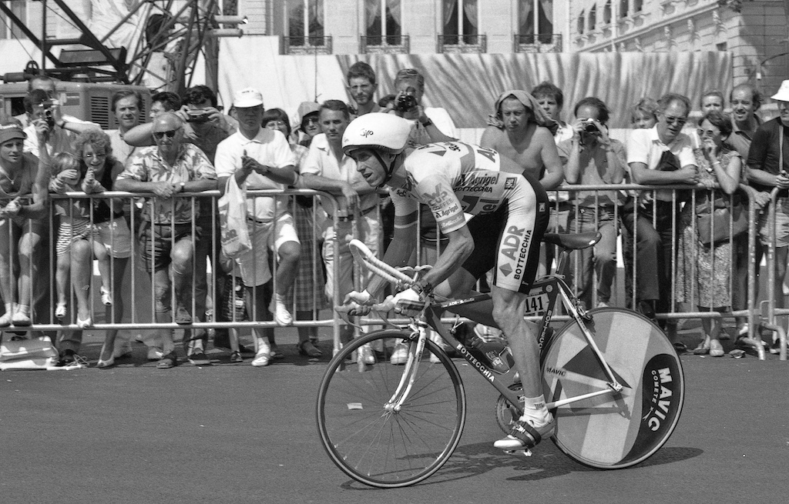

Case Study: The Eight-Second Tour
MS | Math | Case Study | 2026-27 | Adventure

---

## Overview

The night before the last stage of the Tour, the team hotel smells of massage oil and cold coffee, and the sports director is the only one still awake with a notebook open.

Three weeks of racing have come down to a single ride on a single afternoon: Versailles to the Champs-Élysées, against the clock, one rider at a time. The team's rider trails the race leader, and everything now depends on how he sits on the bike.

On the desk are two sketches of the same rider. In one he is up on the hoods (the brake-lever housings on the handlebars), the way nearly everyone in the race sits. In the other he is folded forward over a pair of narrow handlebar extensions, elbows tucked, chin low, a posture borrowed from triathlon that most of the Tour's riders have never tried in a race this important. The folded rider cuts through the wind better. He also, everyone on the team agrees, cannot push as hard.

Nobody on the team can say by how much either claim is true.

Down the corridor the rider is trying to sleep. The wind tunnel is a country away, and tomorrow does not wait for it. The director turns to a clean page, uncaps the pen, and writes two words at the top, one for each sketch.

---

## Background

**The role.** A **sports director** (in French cycling, a *directeur sportif*) runs a professional team from the follow car (the team car that drives behind the riders): race tactics, equipment, and the choices a rider cannot make for himself in the middle of a ride. This case puts you in that seat on the evening before stage 21 of the 1989 Tour de France, an individual **time trial**: riders start alone, one after another, and the fastest elapsed time wins. The stage ran 24.5 km from Versailles to the Champs-Élysées on 23 July 1989 [S1]. Your rider, Greg LeMond, entered the stage 50 seconds behind the race leader, Laurent Fignon, in the overall standings [S1]. The Tour is a three-week race of daily stages; each rider's stage times are added into a running total and the lowest total wins, so "50 seconds behind" means 50 seconds back in that total.

**A hindsight scenario, stated plainly.** The real stage is history: LeMond finished in 26:57 and Fignon in 27:55, and LeMond won the Tour by 8 seconds, the closest margin ever [S1]. The director on the evening before the stage could not have known Fignon's time. This case uses it anyway, as a stand-in for the time you would *expect* your rival to ride. What the director *could* know is how the two riders had matched up in the Tour's three earlier individual time trials (SEE APPENDIX A), and the case uses that record as a baseline: **in the conventional position, LeMond rides at least as fast as Fignon, by a speed ratio b that you take from the earlier time trials, anywhere between the smallest and largest ratio they show.** Treat that record with care: the distances and terrain differ, form differs from day to day, and Wikipedia says LeMond used triathlon bars (the same extensions as aero bars) in stage 5 (it does not say what he used in the prologue or stage 15), so none of the three can be called a pure conventional-position ride. LeMond's own stage 21 time is not used as a baseline. To win the Tour, LeMond must finish at least 50 seconds faster than 27:55 on stage 21.

**In plain terms:** under **Full Power** LeMond rides the conventional position and gains on Fignon only what his baseline b gives him. Under **Aero Bars** his speed changes further, by an amount that depends on x and y (below): the two effects multiply, so LeMond's total speed ratio over Fignon is b times the aero position's own speed ratio. A made-up illustration (not this case's numbers): if b were 1.02 and the aero position's own speed ratio were 1.03, LeMond would be 1.02 × 1.03 = 1.0506 times as fast as Fignon, about 5.1% faster. The total ratio LeMond needs on stage 21 is Fignon's 27:55 divided by the finish time that beats the Tour: 27:55 divided by (27:55 minus 50 seconds), both in seconds. Fignon's 27:55 is treated as fixed (it is the stand-in for the time you expect). **Full Power** names a posture, not extra effort. Both options are compared on predicted speed, and the 50-second bar is then the test of whether the faster option is fast enough. LeMond's own real 26:57 is not part of the decision; it appears only in D1 and D5 as a check on the model. This is a constructed decision, not a record of what anyone on the real team knew or said, and the case invents no quotes.

**The two options.** **Aero Bars** means riding the stage in the aerodynamic (aero-bar) position: lower air drag, but less power the rider can sustain, meaning the watts he can keep up for the whole ride. **Full Power** means riding the conventional position at full power: the posture every rider in the race knows, with nothing given up. On the real day LeMond used aero bars, an aerodynamic helmet and a rear disc wheel; Fignon used ordinary handlebars, no helmet and two disc wheels [S1]. (A disc wheel is a solid, flat wheel that slips through air more easily than a spoked one; aero bars are extensions that let a rider rest on the forearms and tuck forward.) The helmet and wheels are outside this case's model, which compares only the handlebar position (SEE APPENDIX A). Reports about Fignon's physical condition that day are contested and are kept out of the math.

**The physics you will use.** At race speed most of a rider's power is spent pushing air aside, and that power grows with the **cube** of speed. Aero Bars cuts drag by some fraction **x** (the cut in drag area, CdA) but costs some fraction **y** of the rider's sustainable power. Drag area is the rider-and-bike's effective air-catching size (how slippery the shape is, the drag coefficient, times how big it looks head-on, the frontal area). Why would a tucked rider lose power? One of the studies below says only that a lower torso angle reduces drag but "limits the physiological functioning of the cyclist" [S4]; how much is exactly what nobody measured. A full model adds a smaller rolling-resistance term (tyre-on-road friction). The formulas and parameters are in Appendix B, and they are scenario parameters, not measurements of LeMond: they do not reproduce his real speed, and D5 asks you to see how far off they are. For that reason this case uses **ratios only** and never claims LeMond produced any particular power. Equally, nothing here claims how many seconds the handlebar position gained him.

**What the literature gives, and what it does not.** Two peer-reviewed studies bear on the question (SEE APPENDIX C). Neither compares aero bars against a conventional position, and their numbers come from different comparisons. So x = 10-15% and y = 3-14% are a **sensitivity range, not a measurement**, and the 3% lower bound is this case's own assumption (SEE APPENDIX D). The honest tension is how much power loss the position can tolerate, not a coin flip.

**What you must decide.** Your decision is which position gives LeMond the faster ride tomorrow, and how confident you can honestly be about it. Primary metric: each option's predicted average speed over the 24.5 km under the scenario model. The 50-second target is then a second test of how far each option gets you, and the case does not assume either option reaches it. Every figure here is either cited (SEE APPENDIX E) or a stated assumption (SEE APPENDIX D). The vocabulary and "how to…" skills for Challenge 1 are in Appendix F.

---

## Dilemma

You are the sports director of Greg LeMond's team.

Do you:

**A.)** Commit LeMond to **Aero Bars**: the aero position, with lower drag and less sustainable power **OR**

**B.)** Ride LeMond in the conventional position at **Full Power**

---

## Challenges

1.) Research and find an online resource that answers one of the "how to…" questions from the
case study launch. Post a link to the resource as your submission.

2.) Post 250 or more "excellent" words pitching a firm stance to your audience on which you
would choose and why. Your pitch must include:
    a.) Use of the "how to…" resource you researched in Challenge 1.
    b.) At least one original visual display of the data.

3.) Your pitch must include:

- **D1 — A times-and-speeds table.** For the prologue, stage 5, stage 15 and stage 21 (Appendix A), convert LeMond's and Fignon's times to seconds (add each listed gap to the winner's time where one is given), calculate each rider's average speed in km/h, and calculate the speed ratio LeMond/Fignon for each time trial. State the baseline range for b (the smallest and largest of the three earlier ratios, to four decimal places). Then convert the 50-second deficit to the finish time LeMond needs on stage 21 to tie Fignon on the Tour, and the total speed ratio he needs over Fignon's 27:55 pace.
- **D2 — The needed power factor.** The baseline already supplies part of the needed ratio, so the aero position must supply the rest: divide the total ratio from D1 by b, once for each end of your baseline range. Using Appendix B's aero-only relationship, in which power grows with the cube of speed at fixed drag, calculate the factor by which power must rise to reach each of those two ratios, and state each as a percent increase.
- **D3 — A break-even table.** For drag-area cuts x of 10%, 14%, 15% and 20%, calculate the largest power loss y at which the aero position still just reaches the ratio D2 requires, using the aero-only form, once for each end of your baseline range. Then repeat the calculation with Appendix B's full two-term model for x = 10% and x = 15% at the lower end of your baseline range, and say which model tolerates less power loss and why.
- **D4 — An original break-even chart.** Plot your aero-only (x, y) break-even points from D3 for both baselines (two lines), shade the sensitivity range from Appendix D (x from 10% to 15%, y from 3% to 14%), and mark the (x, y) pair you believe. Write the equation of the line for the lower baseline, identify its slope, and say what the slope means for the director in plain words. Estimate what share of the shaded range lies on the winning side of each line, and say which decision rule you use to choose between the two options (for example, best expected result, or best worst case) and why.
- **D5 — Model limits, in numbers and words.** Use the full model to calculate the power Appendix B's parameters imply for LeMond's real 26:57 average speed, and say whether you find that figure sustainable for a ride of about 27 minutes and why. The case gives no reference for a sustainable wattage: find one yourself, cite it, and say how much weight you give it. Then, in a short paragraph, explain why this case uses ratios only, what the literature in Appendix C does and does not support, and name two things the model leaves out.

4.) An appendix showing evidence of your original thinking, work, calculations and processes you
used to complete the challenges (pictures, screenshots, notes, etc.). Your work in the appendix
does not count toward your word count.

5.) Participate twice or more in the Case Study discussion. *If you are absent the day of a
discussion post 500 "excellent" words on the questions above.

---

## Appendix A — The Stage and the Real Times

Referenced in Background and Challenge 3 (D1, D5). The earlier time trials are given as the sources list them: a winner's time with each rider's gap, or the rider's own time. Times are in whole seconds. To use the table: where a rider's entry is "winner + a gap", add the gap to the winner's time to get that rider's own time; a rider's average speed is distance divided by time; and the ratio for a time trial is LeMond's speed divided by Fignon's. You will have one ratio per time trial, and b can be any value between the smallest and largest of the three earlier ones.

| Fact | Value | Source |
|---|---|---|
| Stage | 21, individual time trial, Versailles to the Champs-Élysées | [S1] |
| Date | 23 July 1989 | [S1] |
| Distance | 24.5 km | [S1] |
| LeMond's real time (stage 21) | 26:57 | [S1] |
| Fignon's real time (stage 21) | 27:55 | [S1] |
| Fignon's lead entering the stage | 50 seconds | [S1] |
| Final winning margin | 8 seconds | [S1] |
| LeMond's equipment (real) | aero bars, aero helmet, rear disc wheel | [S1] |
| Fignon's equipment (real) | ordinary handlebars, no helmet, two disc wheels | [S1] |

**The Tour's earlier individual time trials** [S5][S6]

| Time trial | Date | Distance | Winner's time | LeMond | Fignon |
|---|---|---|---|---|---|
| Prologue (a short opening time trial), Luxembourg | 1 July 1989 | 7.8 km | Breukink 9:54 | winner + 6 s | winner + 6 s |
| Stage 5, Dinard to Rennes | 6 July 1989 | 73 km | LeMond 1:38:12 | 1:38:12 | winner + 56 s |
| Stage 15, Gap to Orcières-Merlette (mountain) | 16 July 1989 | 39 km | Rooks 1:10:42 | winner + 57 s | winner + 1:44 |

Wikipedia notes that LeMond (with two other riders) used triathlon bars in stage 5; it does not give the equipment for the prologue or stage 15 [S5].

*Greg LeMond at the start of the stage 21 time trial, Versailles, 23 July 1989. The photo shows the start, not the finish or the ride. Photo: Benjamin Werner (Flickr user bw94), CC BY 2.0, via Wikimedia Commons [S2].*

---

## Appendix B — The Power Model (scenario parameters)

Referenced in Background and Challenge 3 (D2, D3, D5). These are **scenario parameters, not measurements of LeMond** (SEE APPENDIX D).

Power to hold a steady speed v (in metres per second) on flat ground with no wind:

- **Aero-only (cube-law) form:** P(aero) = ½ × ρ × CdA × v³
- **Full model:** P(total) = ½ × ρ × CdA × v³ + Crr × m × g × v, where the second term is rolling resistance

| Symbol | Meaning | Value used |
|---|---|---|
| ρ | air density | 1.225 kg/m³ |
| CdA | drag area, conventional position | 0.32 m² |
| Crr | rolling-resistance coefficient | 0.004 |
| m | rider plus bike mass | 78 kg |
| g | gravitational acceleration | 9.81 m/s² |

**Aero Bars versus Full Power, in symbols.** In the aero position the drag area becomes CdA × (1 − x) and the sustainable power becomes (1 − y) times the conventional power. In the aero-only form, at a fixed speed the power needed scales with drag area, so the aero position runs at a speed ratio of ((1 − y) / (1 − x)) raised to the power 1/3, compared with the conventional position. In the full model, rolling resistance does not shrink when drag area does, so you will find the break-even by comparing total power at the two speeds.

**Figure B1 — what a labeled chart looks like (an example, not a deliverable).** Aero-only power from the formula above, plotted for speeds from 20 to 40 km/h with the Appendix B drag area. The points are marked every 5 km/h. Note how the curve steepens: power does not grow in step with speed. Your own chart in D4 plots different quantities (the break-even points from D3), so use this only as a model for labeling axes and marking points.

<svg id="exampleChart" aria-label="Example chart: aero power against speed, 20 to 40 km/h" viewBox="0 0 520 300" xmlns="http://www.w3.org/2000/svg" style="max-width:520px;width:100%;border:1px solid #999;background:#fafafa;font-family:sans-serif">
  <line x1="55" y1="250.0" x2="60" y2="250.0" stroke="#333"/><line x1="60" y1="250.0" x2="500" y2="250.0" stroke="#ddd"/><text x="50" y="254.0" font-size="11" text-anchor="end">0</text><line x1="55" y1="173.3" x2="60" y2="173.3" stroke="#333"/><line x1="60" y1="173.3" x2="500" y2="173.3" stroke="#ddd"/><text x="50" y="177.3" font-size="11" text-anchor="end">100</text><line x1="55" y1="96.7" x2="60" y2="96.7" stroke="#333"/><line x1="60" y1="96.7" x2="500" y2="96.7" stroke="#ddd"/><text x="50" y="100.7" font-size="11" text-anchor="end">200</text><line x1="55" y1="20.0" x2="60" y2="20.0" stroke="#333"/><line x1="60" y1="20.0" x2="500" y2="20.0" stroke="#ddd"/><text x="50" y="24.0" font-size="11" text-anchor="end">300</text>
  <line x1="60" y1="250" x2="500" y2="250" stroke="#333"/><line x1="60" y1="20" x2="60" y2="250" stroke="#333"/>
  <line x1="60.0" y1="250" x2="60.0" y2="255" stroke="#333"/><text x="60.0" y="269" font-size="11" text-anchor="middle">20</text><line x1="170.0" y1="250" x2="170.0" y2="255" stroke="#333"/><text x="170.0" y="269" font-size="11" text-anchor="middle">25</text><line x1="280.0" y1="250" x2="280.0" y2="255" stroke="#333"/><text x="280.0" y="269" font-size="11" text-anchor="middle">30</text><line x1="390.0" y1="250" x2="390.0" y2="255" stroke="#333"/><text x="390.0" y="269" font-size="11" text-anchor="middle">35</text><line x1="500.0" y1="250" x2="500.0" y2="255" stroke="#333"/><text x="500.0" y="269" font-size="11" text-anchor="middle">40</text>
  <polyline points="60.0,224.2 82.0,220.2 104.0,215.7 126.0,210.8 148.0,205.5 170.0,199.7 192.0,193.4 214.0,186.6 236.0,179.3 258.0,171.4 280.0,163.0 302.0,154.1 324.0,144.5 346.0,134.3 368.0,123.4 390.0,111.9 412.0,99.7 434.0,86.9 456.0,73.3 478.0,58.9 500.0,43.9" fill="none" stroke="#1a3a5c" stroke-width="2"/>
  <circle cx="60.0" cy="224.2" r="3.5" fill="#1a3a5c"/><circle cx="170.0" cy="199.7" r="3.5" fill="#1a3a5c"/><circle cx="280.0" cy="163.0" r="3.5" fill="#1a3a5c"/><circle cx="390.0" cy="111.9" r="3.5" fill="#1a3a5c"/><circle cx="500.0" cy="43.9" r="3.5" fill="#1a3a5c"/>
  <text x="280" y="290" font-size="12" text-anchor="middle">speed (km/h)</text>
  <text x="14" y="135" font-size="12" text-anchor="middle" transform="rotate(-90 14 135)">aero power (W)</text>
</svg>

**Unit reminder:** 1 km/h = 1/3.6 m/s.

---

## Appendix C — What the Literature Does and Does Not Give

Referenced in Background and Challenge 3 (D5).

| Study | What it reports | What it does not give |
|---|---|---|
| García-López et al. 2008, *Journal of Sports Sciences* 26(3):277-286, wind tunnel (a lab that blows controlled air past a rider and bike to measure drag), five professional cyclists [S3] | Changes in the cyclists' position decreased aerodynamic drag by 14%. Drag only. | Any power loss. Its 14% comes from changing position, not from a comparison of aero bars with a conventional position. |
| Fintelman et al. 2014, *Journal of Biomechanics* 47(8):1894-1898, models built from 19 time-trial cyclists at torso angles of 0-24° (how far the back is tilted down from upright) [S4] | Aerodynamic losses outweigh power losses at cycling speeds above 46 km/h. Below 30 km/h a more upright position is better. | A power-loss figure for aero bars versus a conventional position. |

LeMond averaged 54.545 km/h over the stage [S1], well above Fintelman's 46 km/h crossover, so the literature leans toward the aero position at race speed. That does not tell you **how much** power loss the position tolerates, which is the question the numbers must answer. The two studies measured different things, so their numbers cannot be combined into one comparison. Popular "15-25%" drag-reduction figures for aero bars circulate widely, but they are not peer reviewed and are not used here.

---

## Appendix D — Modeling Assumptions

> These figures are **not sourced**. They are stated scenario assumptions chosen by the case author. A Hero may challenge them in discussion — that is a legitimate move.

| # | Assumption | Value used | Basis | Sensitivity |
|---|---|---|---|---|
| MA1 | Hindsight stand-in and baseline: the rival's expected stage 21 time is Fignon's real 27:55, and LeMond's conventional-position speed is Fignon's speed times a baseline ratio b taken from the earlier time trials (the range in D1) | 27:55; b between the smallest and largest earlier ratio | A director could not have known Fignon's time, but could know the earlier time trials. Their distances, terrain, form and (for stage 5) equipment differ, so b is an indicative range, not a measurement of either rider's conventional position. | The 50-second test is sensitive to this value. |
| MA2 | Fractional cut in drag area (x) from the aero position | Range 10-15% | A peer-reviewed 14% drag change [S3] was measured for position changes among time-trial positions, not aero bars versus a conventional position, so it anchors the range but does not measure it. | The answer is sensitive to this value. |
| MA3 | Fractional loss in sustainable power (y) in the aero position | Range 3-14% | No source found that measures this for aero bars against a conventional position. The 3% lower bound is this case's own assumption. | The answer is sensitive to this value. |
| MA4 | Power-model parameters (ρ, CdA, Crr, m) | Appendix B | Typical scenario values for a rider and bike on flat ground; not LeMond's. They do not reproduce his real speed. | The break-even tolerances depend on the rolling-resistance share these parameters set. |
| MA5 | Flat course, no wind, steady speed, no drafting (riding in another rider's slipstream) | as stated | Simplification for tractable arithmetic. Wikipedia describes the weather on stage 21 as hot, dry and still [S6]. | The real course and weather are ignored. |
| MA6 | Only handlebar position changes; helmet and wheels are held equal | as stated | Isolates the question the director faces in this case. | The real equipment differences listed in Appendix A are ignored. |

---

## Appendix E — Sources

| # | Claim | Value | Source | Date | Confidence |
|---|---|---|---|---|---|
| S1 | Stage 21 facts: date, distance, real times, 50 s deficit, 8 s margin, equipment, 54.545 km/h average | as tabulated in Appendix A | Wikipedia — [1989 Tour de France](https://en.wikipedia.org/wiki/1989_Tour_de_France) (secondary; ProCyclingStats is not openly licensed) | accessed 2026-10-03 | MEDIUM |
| S2 | Photograph of LeMond at the stage 21 start | CC BY 2.0, Benjamin Werner (Flickr user bw94) | Wikimedia Commons — [File:Greg LeMond 1989 Tour de France stage 21 TT.jpg](https://commons.wikimedia.org/wiki/File:Greg_LeMond_1989_Tour_de_France_stage_21_TT.jpg); original [Flickr](https://www.flickr.com/photos/bw94/2927911618/) | accessed 2026-10-03 | MEDIUM |
| S3 | Position changes decreased aerodynamic drag by 14% in five professional cyclists (wind tunnel) | 14% | García-López J. et al., *Reference values and improvement of aerodynamic drag in professional cyclists*, J Sports Sci 2008;26(3):277-286 — [PubMed 17943597](https://pubmed.ncbi.nlm.nih.gov/17943597/) (abstract read) | 2008 | HIGH |
| S4 | Aerodynamic losses outweigh power losses above 46 km/h | 46 km/h | Fintelman D.M. et al., *Optimal cycling time trial position models: aerodynamics versus power output and metabolic energy*, J Biomech 2014;47(8):1894-8 — [PubMed 24726654](https://pubmed.ncbi.nlm.nih.gov/24726654/) (abstract read) | 2014 | HIGH |
| S5 | Prologue and stage 5 results (7.8 km; 73 km), and that LeMond, Yates and Hampsten used triathlon bars in stage 5 | as tabulated in Appendix A | Wikipedia — [1989 Tour de France, Prologue to Stage 10](https://en.wikipedia.org/wiki/1989_Tour_de_France,_Prologue_to_Stage_10) (secondary; ProCyclingStats is not openly licensed) | accessed 2026-10-03 | MEDIUM |
| S6 | Stage 15 mountain time trial result (39 km), stage 21 details and weather | as tabulated in Appendix A | Wikipedia — [1989 Tour de France, Stage 11 to Stage 21](https://en.wikipedia.org/wiki/1989_Tour_de_France,_Stage_11_to_Stage_21) (secondary) | accessed 2026-10-03 | MEDIUM |

<!-- FACILITATOR ONLY: balance argument, margin, and sensitivity notes live in FACILITATOR.md and case.json's balance object, not here. -->

---

## Appendix F — "How To…" Math Questions To Research

**Vocabulary terms**

- Time
- Percent
- Ratio
- Exponent (also Power)
- Variable
- Equation
- Scatter Plot

**"How to…" questions**

- How to convert between units of time
- How to add and subtract time
- How to convert an amount with compound units
- How to evaluate an exponential expression
- How to convert numbers to percents
- How to convert percents to numbers
- How to evaluate a variable expression (Substitution Property)
- How to solve a multi-step equation with a variable on one side
- How to create a scatter plot given a set of data
- How to identify the slope of a line given a set of data, or a graph of a line of a set of data, or its linear equation
- How to write a linear equation given a set of data

