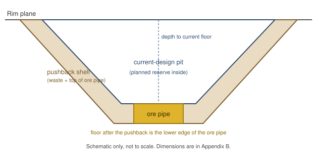

# Case Study: The Last Bench

MS | Math | Case Study | 2026-27 | Launchpad

*(Band: MS-stretch / HS-entry. This case uses cone and cylinder volume, compound-unit conversion, percent, and a break-even equation, applied to an open-pit mine closing-or-extending decision. The mine, the town and the people are a constructed scenario; the gold price series is real.)*

---

## Overview

Corwin Brandvold stands on the last bench of the pit, the lowest working terrace cut into its wall, at shift change, hard hat in his hand, watching the haul trucks crawl up the ramp in single file like ants on a wall. Diesel and wet dust hang in the cold air. Far below him the pit floor has been scraped almost clean, and the floodlights are already buzzing on against a sky the color of slate.

The drill cores say there is one more block of gold-bearing rock down there. Reaching it would mean cutting the whole rim back and hauling a mountain of barren rock up that ramp first, truck after truck, for years. Leaving it means the ramp goes quiet.

Up on the rim the first-shift crew is lining up outside the dry shed, steam coming off their coffee. Corwin knows most of their kids by name. He has coached some of them in the town league. A driver he has known for a decade lifts two fingers off the wheel at him as her truck rolls past, the way she does every shift, and he lifts a hand back without deciding to.

The board wants his recommendation on Monday. He has run his own numbers twice, and each time they sit uncomfortably close together. The last truck of the shift pulls out of the lower bench and stops at the foot of the ramp, engine idling, the driver's window sliding down. She is not asking anything. She is waiting for him to say which way the trucks go tomorrow.

---

## Background

Corwin Brandvold is the planning engineer at Quartz Mesa, a fictional open-pit gold mine outside the fictional town of Ebbet Wells. He does not own the company, but his recommendation to the board carries the engineering case for whichever path the mine takes. He is accountable for the pit design, the haulage plan and the cash forecast (SEE APPENDIX C).

An open-pit mine is dug in terraces called **benches**. Rock that carries enough gold to be worth processing is **ore**; everything that must be moved to reach it is **waste rock**. The approved pit design has a flat floor 180 m in radius, 300 m below the rim, with walls cut at a constant slope (SEE APPENDIX B). The ore still to be mined inside that design, the **planned reserve**, together with the waste that must move with it, is fixed and is mined in either option (SEE APPENDIX C). Tonnes are metric tonnes; **Mt** means million tonnes. "Rock moved" always means ore plus waste.

The two options are:

**Close at the Floor.** Mine the planned reserve and nothing more. The pit then stops at its current floor and the mine closes. This option still moves every tonne of the planned reserve's ore and waste; it simply stops there.

**The Sixty-Meter Pushback.** Mine the same planned reserve, and in addition approve a **pushback**: a planned expansion that deepens the pit by 60 m and widens its rim, keeping the same floor radius and the same wall slope, to reach a cylindrical pipe of ore that lies directly below the current floor (SEE APPENDIX B). The pushback requires capital spending to start and moves a very large amount of waste rock for each tonne of ore it uncovers. The **stripping ratio** of the pushback is the tonnes of waste moved per tonne of ore uncovered.

The metric for the board is the **life-of-pit cash margin**, undiscounted, in millions of dollars. It is the value of the gold recovered from all ore, minus the processing cost of that ore, minus the mining cost of all rock moved (ore and waste), minus any pushback capital (SEE APPENDIX C). The gold price used is the planning office's price deck: the most recent complete-year average in the USGS series available when this recommendation was drafted, the 2024 average (SEE APPENDIX A). **Margin between the two options is always stated as the gap divided by the larger (winning) cash margin.**

A second lens matters to Corwin even though it is not the board's metric: the people who work the pit. The mine employs a crew, and the crew works for as long as the pit operates. The crew and town figures are scenario inputs that anyone may challenge (SEE APPENDIX D). All sourced figures are listed in Appendix E, and the vocabulary and "How To…" questions are in Appendix F.

*Words used in this case, with sources: bench and stripping ratio [S2]; pushback [S3]; head grade [S4]; waste rock [S5]; troy ounce [S6].*

---

## Dilemma

You are Corwin Brandvold.

Do you:

**A.)** Close at the Floor: mine out only the planned reserve (25 Mt of ore plus the 50 Mt of waste that must be moved with it, 75 Mt in all) and close the pit **OR**

**B.)** Approve the Sixty-Meter Pushback: widen and deepen the pit by 60 m to reach the next block of ore, on top of that same planned reserve

---

## Challenges

1.) Research and find an online resource that answers one of the "how to…" questions from the case study launch. Post a link to the resource as your submission.

2.) Post 250 or more "excellent" words pitching a firm stance to your audience on which you would choose and why. Your pitch must include:
    a.) Use of the "how to…" resource you researched in Challenge 1.
    b.) At least one original visual display of the data.

3.) Your pitch must include the following five artifacts:

- **D1 — A pit volume table.** Using the given radii and heights in Appendix B and the cone volume formula, build a table of the volume (in million cubic meters, Mm³) of the current-design pit and of the pit after the pushback, each found as one large cone minus the small cone removed at the floor. Report the pushback shell (the difference between the two pits) in Mm³ and, using the rock density, in million tonnes (Mt). Check the shell a second way, and say in one sentence why the small floor cone does not affect the shell.
- **D2 — An ore-pipe and stripping table.** Using the cylinder volume formula, find the volume of the 60 m of ore pipe uncovered by the pushback (Mm³), its tonnage (Mt), and the troy ounces of gold recovered from it. Then give the waste tonnage inside the pushback shell and the pushback's stripping ratio. Show every unit conversion.
- **D3 — A cash-margin table and a break-even gold price.** For Option A and Option B at the planning-price-deck price, show the recovered value per tonne of ore, each option's life-of-pit cash margin in $M, and the margin between them stated as (winner minus loser) divided by winner, as a percent. Then write each option's cash margin as an equation in the gold price P and solve algebraically for the price at which the two options tie.
- **D4 — A stake table.** Using the throughput and crew in Appendix D, give each option's mine life in years and its crew-years of work, the extra crew-years Option B provides, the forgone cash per extra crew-year (the Option A cash margin minus the Option B cash margin, divided by the extra crew-years), and the crew as a percent of the town's population.
- **D5 — An original visual.** Draw the two cash-margin equations from D3 as lines against gold price on one set of axes. Plot the four USGS annual prices in Appendix A as points on the lines, and mark the break-even price. This satisfies Challenge 2(b).

*Optional extensions (not required for the pitch): (E1) for each of the four USGS years, compare the pushback's stripping ratio with the break-even stripping ratio, and state the one-line rule that follows; (E2) rerun D4 with a crew size or throughput you choose and justify; (E3) test whether discounting changes your answer, using the convention stated in Appendix C.*

4.) An appendix showing evidence of your original thinking, work, calculations and processes you used to complete the challenges (pictures, screenshots, notes, etc.). Your work in the appendix does not count toward your word count.

5.) Participate twice or more in the Case Study discussion. *If you are absent the day of a discussion post 500 "excellent" words on the questions above.

---

## Appendix A: The Planning Price Deck

The gold price is the one real, sourced series in this case. It is the annual average price of gold in US dollars per troy ounce, as reported by the US Geological Survey.

| Year | Average gold price (USD per troy ounce) |
|---|---|
| 2021 | 1,801 |
| 2022 | 1,802 |
| 2023 | 1,945 |
| 2024 | 2,388 |

*Source: USGS Mineral Commodity Summaries 2026 (published February 2026), Gold, "Salient Statistics", row "Price, dollars per troy ounce", defined as Engelhard's average gold price quotation for the year [S1]. The case's planning-price-deck price is the 2024 value. The cited publication also contains figures for later periods; they are deliberately not part of this decision.*

*Unit conversion (from the same USGS publication [S1]): 1 metric ton = 32,150.7 troy ounces. All tonnes in this case are metric tonnes.*

*As-of statement: all price data is frozen at the USGS publication named above; the case cutoff date is 2026-10-28.*

---

## Appendix B: Pit Geometry

The mine is a scenario construction (Appendix C, MA1-MA5). The pit is an upside-down truncated cone: a flat circular floor, walls rising at a constant slope to a circular rim. Each pit is described as one **large cone** minus the **small cone** below its floor. To see why, imagine the sloping walls continued straight down, past the floor, until they meet at a single point, the apex: that is the large cone. The tip of it below the floor was never dug, so it is the small cone. The pushback keeps the same floor radius and the same wall slope, so the apex does not move; the floor and the rim both sit lower. The **pushback shell** is the rock between the two pit outlines: the ring of rock around the old walls plus the slab of rock under the old floor. The ore pipe lies entirely inside the shell, so the shell's tonnes include the pipe's tonnes, and the waste in the shell is the shell's tonnes minus the pipe's tonnes.

| Quantity | Current-design pit | Pit after the pushback |
|---|---|---|
| Depth of floor below rim | 300 m | 360 m |
| Floor radius | 180 m | 180 m |
| Wall angle (overall slope from horizontal) | 42 degrees | 42 degrees |
| Rim radius (given) | 513.18 m | 579.82 m |
| Height of the large cone, apex to rim plane (given) | 462.07 m | 522.07 m |
| Height of the small floor cone, apex to floor plane (given) | 162.07 m | 162.07 m |

*Figure: schematic cross-section, not to scale (illustration by the case author; no real mine). The dimensions are in the table above.*

**Ore pipe.** A vertical cylinder of ore, radius 140 m, lies directly below the current floor, centered on the pit axis. The pushback uncovers the top 60 m of it. **Rock density** (ore and waste alike): 2.6 t per cubic meter.

**Other wall-angle designs the planning office considered and set aside** (rim radius before / after the pushback; same floor radius and depths):

| Wall angle | Rim radius, current | Rim radius, after pushback |
|---|---|---|
| 38 degrees | 563.98 m | 640.78 m |
| 50 degrees | 431.73 m | 482.08 m |

*The rim radii and cone heights above were computed from the depths, floor radius and wall angle by right-triangle trigonometry and are given so that no trigonometry is needed.*

---

## Appendix C: Modeling Assumptions

> These figures are **not sourced facts**. They are stated scenario assumptions chosen by the case author; no real mine is represented. A Hero may challenge them in discussion. That is a legitimate move.

| # | Assumption | Value used | Basis |
|---|---|---|---|
| MA1 | Pit geometry: depths, floor radius, wall angle, ore-pipe radius, rock density (Appendix B) | as stated in Appendix B | Round scenario dimensions of a plausible large open pit; chosen so the volumes are in the range a student can handle. The result is sensitive to these inputs. |
| MA2 | Planned reserve, mined in both options | 25 Mt of ore and 50 Mt of waste | The ore and waste remaining inside the approved pit design. A scenario figure. |
| MA3 | Head grade and processing-plant recovery, same for the planned reserve and the pushback ore | 1.0 g of gold per tonne of ore; 88% of the gold in the ore recovered | Round values in the general range reported for large-scale gold processing; not taken from any particular mine. The result is sensitive to both. |
| MA4 | Costs | Mining 3.00 USD per tonne of rock moved (ore and waste alike); processing 22 USD per tonne of ore; pushback capital 60 USD million | Scenario figures. Capital is spent when the pushback begins. The result is sensitive to each. |
| MA5 | Throughput | 20 Mt of rock moved per year | Used only for mine life, crew-years and the optional discounting test. Throughput counts ore plus waste. |
| MA6 | Excluded, by design | Royalties, income and severance taxes, reclamation and closure liabilities, working capital, price risk after the decision, by-product silver | Left out so the metric is a simple, comparable cash margin. A Hero may argue any of these should be in. |
| MA7 | Metric is undiscounted | Optional discounting test (E3): 8% per year; the planned reserve is mined first and the pushback after it; cash flows are taken at the middle of each year of production (a part-year is prorated); pushback capital is paid when the pushback begins, that is, when the planned reserve is finished | A stated convention so that anyone who tests discounting uses the same one. |
| MA8 | As-of date | Prices frozen at the USGS publication in Appendix A; case cutoff 2026-10-28 | SPEC rule for real, still-changing prices. |

---

## Appendix D: Stake Scenario Sheet

These are **scenario inputs, not employment data**. Change them if you can justify the change.

| Quantity | Value |
|---|---|
| Crew employed while the pit operates | 180 workers (all assumed to leave the district when the pit closes) |
| Town of Ebbet Wells, scenario population | 2,100 |
| Throughput (fleet capacity) | 20 Mt of rock per year (Appendix C, MA5) |
| Mine life | rock moved divided by throughput |
| Crew-years of work | mine life in years times crew |

---

## Appendix E: Sources

| # | Claim | Value | Source | Date | Confidence |
|---|---|---|---|---|---|
| S1 | US annual average gold price (Engelhard quotation) 2021-2024, and troy-ounce conversion | 1,801 / 1,802 / 1,945 / 2,388 USD per troy ounce; 1 metric ton = 32,150.7 troy ounces | U.S. Geological Survey, Mineral Commodity Summaries 2026, "Gold" ([PDF](https://pubs.usgs.gov/periodicals/mcs2026/mcs2026-gold.pdf)) | February 2026 (publication page lists versions 1.0 to 1.3, February to May 2026) | HIGH |
| S2 | Definitions of bench and stripping ratio | Bench: a ledge forming one working level from which mineral or waste is mined; stripping ratio: waste removed per unit of ore | Hacettepe University mining engineering lecture notes, "Open Pit Fundamentals" (MAD455) ([PDF](https://yunus.hacettepe.edu.tr/~hmali/notlar/surface/MAD455_MainText.pdf)); and Wikipedia, "Stripping ratio" ([link](https://en.wikipedia.org/wiki/Strip_ratio)) | n.d. | MEDIUM |
| S3 | Definition of pushback | A designated zone of the pit to be mined as a single operation | Datamine, Studio NPVS documentation, "About Pushbacks" ([link](https://docs.dataminesoftware.com/StudioNPVS/2.0/STUDIO_NPVS/About%20Pushbacks.htm)) | n.d. | MEDIUM |
| S4 | Definition of head grade | Grade of the ore as removed from the mine and delivered to the mill | Wikipedia, "Ore grade" ([link](https://en.wikipedia.org/wiki/Ore_grade)) | n.d. | MEDIUM |
| S5 | Waste rock is stripped as the pit deepens | Walls are cut at an angle less than vertical; waste rock is stripped as the pit becomes deeper | Wikipedia, "Open-pit mining" ([link](https://en.wikipedia.org/wiki/Open-pit_mining)) | n.d. | MEDIUM |
| S6 | Definition of the troy ounce | The troy ounce is the standard mass unit for precious metals; it equals 31.1034768 grams | Wikipedia, "Troy weight" ([link](https://en.wikipedia.org/wiki/Troy_ounce)); consistent with the USGS conversion in S1 | n.d. | MEDIUM |

*Contested or estimated figure note: the USGS reports its most recent-year price as an estimate based on part-year data. This case uses only the complete-year values above in the decision.*

---

### Appendix F — "How To…" Math Questions To Research

**Vocabulary terms**

- Cone
- Cylinder

**"How to…" questions**

- How to find the volume of a cone
- How to find the volume of a cylinder
- How to convert an amount with compound units
- How to find the percent of a number
- How to convert numbers to percents
- How to solve a multi-step equation with a variable on both sides
- How to graph a coordinate pair on the coordinate plane
- How to draw a line of a set of data given its linear equation

<!-- FACILITATOR ONLY: balance argument, margin, and sensitivity notes live in FACILITATOR.md and case.json's balance object, not here. -->
